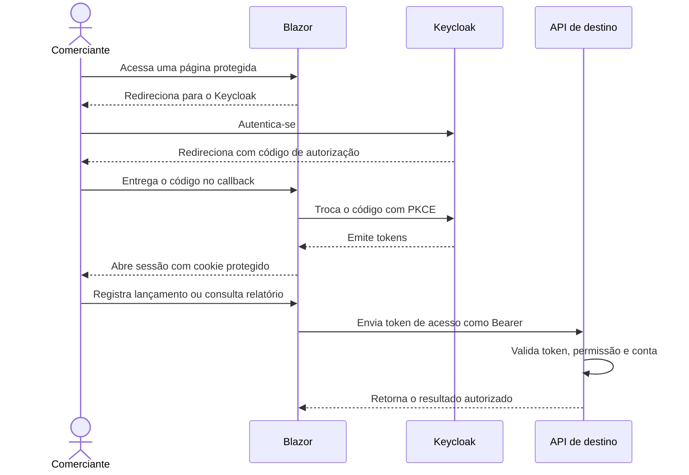

# Identidade e acesso

[Voltar ao índice](index.md)

O enunciado inclui autenticação e autorização entre os pontos de segurança e trata os critérios de integração segura como diferencial. Para a demonstração, o Keycloak autentica pessoas e emite tokens de acesso. As APIs aplicam as regras que determinam o que cada pessoa pode fazer e em qual conta. O ambiente usa identidades e contas de caixa sintéticas.

## Fluxo de login e chamada à API

O realm `fluxo-caixa` tem um cliente confidencial para o Blazor e um cliente de recurso para cada API. O Blazor usa OIDC com Authorization Code e PKCE S256. Os tokens ficam em armazenamento de sessão no servidor e o navegador recebe apenas o cookie protegido. No alvo, as réplicas da web compartilham o armazenamento de sessão e as chaves de proteção. As APIs validam assinatura, emissor, audiência e expiração do token de acesso com as chaves públicas do Keycloak, sem consulta remota por requisição. Login, renovação e descoberta de novas chaves podem depender do Keycloak estar disponível. [OIDC no Keycloak](https://www.keycloak.org/securing-apps/oidc-layers) · [Audiências e papéis no Keycloak](https://www.keycloak.org/docs/26.4.7/server_admin/)

## Permissões

A opção **Sair** encerra a sessão do Blazor e a sessão OIDC no Keycloak e retorna à página inicial. A operação exige um formulário autenticado com proteção antifalsificação. As páginas dinâmicas usam `Cache-Control: no-store`. Se o navegador restaurar uma página protegida do histórico, o conteúdo permanece oculto enquanto uma nova requisição valida a sessão.

Registro, consulta e paginação usam formulários POST autenticados com proteção antifalsificação, seguidos de um redirecionamento HTTP 303 para a página de leitura. Assim, voltar ou atualizar refaz apenas a leitura. Os filtros e a página atual ficam no servidor por sessão autenticada, são compartilhados pelas abas dessa sessão e são descartados ao sair. A interface exibe uma página HTML com status 404 para endereços inválidos. As APIs mantêm seus contratos de erro.

| Recurso | Permissões verificadas pela API | Atribuição inicial |
| --- | --- | --- |
| API de Lançamentos, audiência `lancamentos-api` | `lancamentos.registrar` ou `lancamentos.consultar`, conforme a rota | Operador de caixa |
| API de Consolidado, audiência `consolidado-api` | `consolidado.consultar` | Responsável pelo estabelecimento |

Um usuário pode acumular papéis. O Keycloak configura os papéis por cliente e inclui no token as audiências correspondentes. Para a demonstração com uma conta por usuário, o vínculo é atribuído no provisionamento e emitido em um claim `conta_id` controlado pela administração. Cada API exige a permissão da operação e compara esse vínculo com a conta da URL antes de acessar o banco. A aplicação da regra em cada rota é coberta por CA-11. As credenciais dos workers para SQL Server e RabbitMQ continuam distintas por serviço.

## Ambiente de demonstração

A [identidade visual](identidade-visual.md#aplicação-por-interface) define o tema do formulário de login.

- Subir o Keycloak no Docker Compose, com realm, clientes e papéis provisionados de forma reproduzível. Versionar a configuração sem segredos. Criar usuários sintéticos e gerar segredos locais na preparação do ambiente.
- Usar um banco de identidade dedicado na instância local do **SQL Server 2022 Developer**, com credencial exclusiva do Keycloak. A versão 2022 está na matriz de suporte do Keycloak. Na arquitetura-alvo, prever persistência de identidade separada dos bancos de negócio.
- Configurar o endereço do emissor alcançável pelo navegador e pelos serviços no Docker para descoberta OIDC, callback e validação de tokens. Restringir os endereços de redirecionamento ao Blazor e usar HTTPS no alvo.
- No aceite, validar login real, acesso permitido, token ausente ou inválido, audiência incompatível, permissão ausente e acesso a outra conta. Preparar tokens dos usuários sintéticos do k6 antes da janela de carga, com validade para a execução completa.

[Keycloak em contêiner](https://www.keycloak.org/server/containers) · [Importação de realm](https://www.keycloak.org/server/importExport) · [Bancos compatíveis](https://www.keycloak.org/server/db) · [Configuração de hostname](https://www.keycloak.org/server/hostname)
