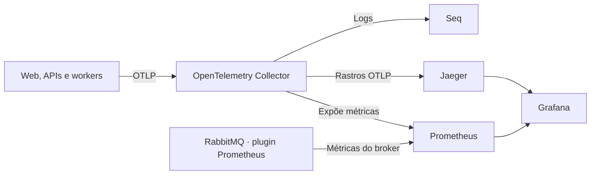

# Operação e segurança

[Voltar ao índice](index.md)

## Probes e dependências

Usar health checks nativos do ASP.NET Core nas APIs e na web. Os workers expõem probes internos no próprio contêiner por um host HTTP mínimo. `/health/live` indica se o processo responde e se seu loop principal permanece ativo, sem consultar dependências remotas. `/health/ready` verifica as dependências da função daquele componente. As respostas externas mostram status simples. Diagnóstico detalhado fica na rede operacional. [Health checks do ASP.NET Core](https://learn.microsoft.com/aspnet/core/host-and-deploy/health-checks)

| Componente | Condição de readiness | Degradação observada separadamente |
| --- | --- | --- |
| Web | Inicialização concluída e configuração de autenticação válida | Estado de cada API. Relatório fora do ar não desvia tráfego da tela de registro |
| API de Lançamentos | SQL de escrita acessível e esquema pronto | Publicador, broker, outbox acumulada e atraso |
| API de Consolidado | SQL de leitura acessível e esquema pronto | Fila, consumidor e atraso do resumo |
| Worker publicador | SQL de escrita e conexão de publicação disponíveis | Idade dos pendentes, recusas do broker e erros de rota |
| Worker de consolidação | Sessão de consumo ativa e SQL de leitura pronto | Entregas atrasadas, falhas consecutivas e DLQ |

A web usa clientes HTTP separados com Polly via `Microsoft.Extensions.Http.Resilience`. A política aplica timeout e circuit breaker por destino, com retentativas limitadas e atraso variável em leituras. Reenvio de lançamento preserva a chave da operação. A saúde do broker e do banco de leitura fica fora do readiness da API de escrita, inclusive no encadeamento de inicialização do Compose.

## Observabilidade

No diagrama, o caminho de métricas representa o fluxo dos dados. Prometheus coleta os endpoints do Collector e do RabbitMQ, e Grafana consulta Prometheus e Jaeger. O dashboard de referência mostra taxa de consultas, erros, latência p95, atraso entre os commits, idade da outbox pendente mais antiga, mensagens prontas, não confirmadas e na DLQ. Durante o teste de carga, a porcentagem de perda vem do gerador para incluir requisições que não chegaram à API. [Fontes de dados do Grafana](https://grafana.com/docs/grafana/latest/datasources/) · [OpenTelemetry no Seq](https://docs.datalust.co/docs/ingestion-with-opentelemetry)

Propagar o contexto W3C entre web e APIs e associar publicação e consumo ao rastreamento do cadastro. Preservar `eventId` nos logs operacionais e usar dimensões de cardinalidade limitada nas métricas, como componente, rota e classe de resultado. Logs operacionais omitem credenciais, tokens, descrições e conteúdo financeiro bruto. O evento de demonstração carrega dados sintéticos.

O dashboard **Fluxo de Caixa Diário** também mostra totais no período selecionado:

- **Consumo das APIs** - total de chamadas, taxa por método e rota, erros por status e latência p95. Os painéis filtram as rotas de negócio em `/v1/`.
- **Lançamentos efetivados** - contagem por crédito e débito após o commit. Reenvios idempotentes e conflitos de chave têm contadores próprios no painel.
- **Entregas ao consolidador** - resultados aplicado, duplicado, inválido e falha no SQL. O valor movimentado em BRL soma créditos e débitos em separado, após uma nova aplicação confirmada no banco. Uma reentrega deduplicada deixa o valor inalterado.

Os totais do Grafana são estimativas operacionais do Prometheus, na janela de processamento selecionada. Para fechar o caixa por data de lançamento e conferir valores exatos, use o relatório consolidado em SQL Server. Nenhuma dessas métricas usa conta, usuário ou identificador de lançamento como dimensão.

Alertas iniciais propostos: DLQ com mensagens, perda HTTP acima de 5% no Consolidado com volume significativo, idade da outbox mais antiga acima de 30 s por dois minutos e redução anormal da taxa de aplicação com fila em crescimento. Revisar limiares após medir a operação. Reservar recursos e limitar retenção para evitar que telemetria dispute armazenamento com o caixa.

## Segurança das integrações

O [desenho de identidade](identidade-e-acesso.md) define o login pelo Keycloak, as audiências de token e as permissões por rota e conta.

| Fronteira | Controles do desenho |
| --- | --- |
| Navegador e Blazor | OIDC com Authorization Code e PKCE, cookies seguros e proteção antifalsificação. Credenciais e tokens das APIs permanecem no servidor web |
| Blazor e APIs | TLS, tokens de acesso validados por assinatura, emissor, audiência e expiração. Permissões separadas para registrar, listar e consultar. Verificação de vínculo com a conta solicitada |
| Workers e RabbitMQ | AMQPS no alvo. Publicador escreve somente na exchange de domínio. Consolidador lê a fila de projeção. Provisionamento, inspeção e reprocessamento usam papéis distintos e auditáveis |
| Aplicação e SQL Server | TLS e identidade própria por componente. API de leitura consulta a projeção. Consolidador grava agregado e inbox. Publicador acessa a outbox. Conta de migração tem privilégios próprios |
| Segredos | Segredos locais gerados fora do Git. Vault no alvo com identidades de serviço, políticas restritas e rotação. Cache de credenciais e renovação planejados para reduzir dependência no caminho de requisição |
| Administração | RabbitMQ Management ligado ao host local para a demo com usuário próprio. No alvo, rede administrativa e autenticação. Scalar e ferramentas operacionais ficam restritos ao público autorizado |
| Dados e cadeia de entrega | Criptografia de discos e backups no alvo. Imagens e dependências versionadas, atualizadas e verificadas no CI. Nenhum dado real é necessário para demonstrar o desafio |

No Compose local, configurar a interface do RabbitMQ em `http://localhost:15672`. O AMQP permanece na rede dos contêineres. As exceções de transporte para o ambiente isolado de demonstração e a forma de obter credenciais devem aparecer no README executável. O funcionamento de segurança do alvo será verificado em ambiente com TLS e identidade configurados.

## Falhas e recuperação

1. **Identificar a fronteira com falha.** Com outbox crescendo e fila estável, verificar rede, credenciais, health do broker e vínculo da exchange. Com fila crescendo e pouca aplicação, verificar sessão do consumidor, banco de leitura, atraso e mensagens em retry. Usar trace e `eventId` na investigação.
2. **Restaurar a dependência.** O publicador retomará eventos ainda pendentes e o consumidor receberá entregas sem ack. Acompanhar redução do backlog. Se o volume for alto, controlar o ritmo com lotes e prefetch para proteger o SQL.
3. **Tratar a DLQ.** Identificar causa e corrigir aplicação, esquema ou configuração antes de reprocessar. Reenviar com o mesmo `eventId` e confirmar roteamento e publicação antes de confirmar a remoção da DLQ. Registrar operação e confirmar impacto no resumo. Eventos incompatíveis ficam em quarentena até haver correção aprovada.
4. **Reconciliar.** Comparar créditos, débitos e quantidade de movimentos por conta e dia entre histórico e projeção após resolver as pendências, incluindo a DLQ. Investigar divergências antes de declarar recuperação. A origem de verdade é o histórico.
5. **Recompor se necessário.** Usar backup ou histórico do SQL de escrita. Reconstruir resumo e inbox juntos em uma projeção isolada a partir de um snapshot consistente, manter os IDs dos eventos originais e alcançar o fluxo pendente antes de trocar a leitura. Na demonstração, um ensaio offline controlado pode reconstruir com as gravações pausadas. Para operação contínua, validar o ponto de corte, captura das escritas concorrentes e troca controlada antes de adotar o procedimento.

O alvo prevê backups automatizados com restauração periodicamente testada e retomada do broker por quorum. RPO e RTO de desastre ficam sujeitos a volume, retenção e validação com operação. A meta de recuperação de 120 s se aplica ao lote definido nos [critérios de aceite](criterios-de-aceite.md#falhas-recuperação-e-capacidade).
