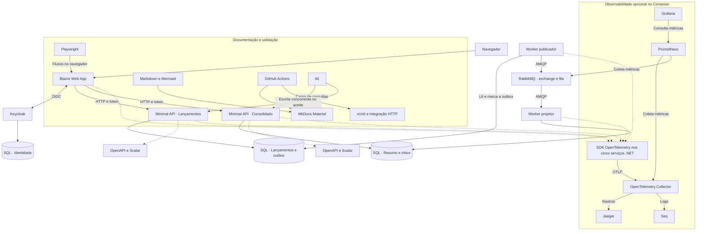

# Catálogo tecnológico

[Voltar ao índice](index.md)

O [System Design](system-design.md) descreve as responsabilidades dos serviços e os fluxos de negócio. Este catálogo mostra quais tecnologias sustentam esses fluxos, como elas se conectam e o que é ativado em cada ambiente. Os arquivos indicados no inventário registram as versões efetivamente utilizadas.

## Inventário

| Área | Tecnologia | Papel | Configuração |
| --- | --- | --- | --- |
| Interface web | .NET 11, ASP.NET Core e Blazor Web App com renderização estática no servidor | Formulários, sessão do usuário e chamadas autenticadas às duas APIs | `src/Web`, `global.json` |
| APIs e contratos | ASP.NET Core Minimal APIs, OpenAPI nativo e Scalar | Uma API registra e consulta lançamentos. A outra entrega o consolidado. Scalar apresenta os contratos localmente | `src/Lancamentos`, `src/Consolidado`, `src/Core/Hosting.cs` |
| Identidade e acesso | Keycloak, OpenID Connect, OAuth 2.0, sessão por cookie na web e JWT Bearer nas APIs | Keycloak autentica e emite tokens. As APIs validam identidade, papéis e acesso à conta | `infra/keycloak`, `src/Web/Program.cs`, [Identidade e acesso](identidade-e-acesso.md) |
| Dados | SQL Server 2022 Developer e `Microsoft.Data.SqlClient` com SQL parametrizado | Uma instância local abriga os bancos de Lançamentos, Consolidado e Identidade. O alvo separa os bancos de escrita e leitura em instâncias independentes | `compose.yaml`, `infra/sql/schema.sql`, `src/Core/Store.cs` |
| Processamento assíncrono | Dois workers .NET com `BackgroundService`, RabbitMQ com Management e `RabbitMQ.Client` | Publicador drena a outbox para o exchange. Projetor consome a fila, deduplica e atualiza o resumo. Management permite inspecionar filas e vínculos | `src/Publicador`, `src/Projetor`, `compose.yaml` |
| Resiliência e verificação de saúde | `Microsoft.Extensions.Http.Resilience` com Polly e health checks nativos do ASP.NET Core | A web aplica timeout, circuit breaker e retentativa em leituras HTTP. Os health checks expõem liveness e readiness. Os workers usam as garantias da outbox e do broker | `src/Web/Program.cs`, `src/Core/Hosting.cs` |
| Instrumentação | SDK .NET do OpenTelemetry e OpenTelemetry Collector | Web, APIs e workers emitem sinais por OTLP. O Collector recebe e roteia por tipo de sinal | `src/Core/Hosting.cs`, `compose.observabilidade.yaml`, `infra/observabilidade/collector.yaml` |
| Métricas | Prometheus e Grafana | Prometheus coleta do Collector e do RabbitMQ. Grafana consulta Prometheus e apresenta painéis | `infra/observabilidade/prometheus.yaml`, `infra/observabilidade/grafana` |
| Logs e rastros | Seq e Jaeger | Seq recebe logs estruturados. Jaeger recebe e exibe rastros distribuídos | `infra/observabilidade/collector.yaml`, `compose.observabilidade.yaml` |
| Contêineres e segredos | Docker, Docker Compose, PowerShell e Bash no ambiente local. HashiCorp Vault na arquitetura-alvo | Docker executa a solução. O setup gera credenciais em `.env`. Os scripts de inicialização sobem a aplicação, a observabilidade e a documentação. Vault está previsto para armazenamento e rotação de segredos no alvo | `infra/Dockerfile`, `compose.yaml`, `scripts/subir.ps1`, `scripts/subir.sh`, [Operação](operacao.md) |
| Documentação | Markdown, Mermaid, MkDocs Material e Python 3.12 no contêiner | Conteúdo versionado com diagramas e portal navegável | `docs/`, `mkdocs.yml`, `requirements-docs.txt` |
| Testes e integração contínua | xUnit, PowerShell, Playwright com Chromium, k6 e GitHub Actions | Testes unitários, integração HTTP, fluxo no navegador e carga. O workflow executa unitários, integração HTTP e compilação estrita do MkDocs | `testes/`, `scripts/caixa-testes.ps1`, `.github/workflows/validar.yml` |

## Relações entre as tecnologias

## Ativação por ambiente

| Contexto | O que roda |
| --- | --- |
| Compose base | Web, APIs, workers, SQL Server, RabbitMQ com Management e Keycloak. Scalar é servido pelas APIs no ambiente de desenvolvimento |
| Compose com observabilidade | Sobreposição `compose.observabilidade.yaml` com Collector, Prometheus, Grafana, Jaeger e Seq |
| Documentação local | Perfil `docs` do Compose ou MkDocs executado via Python |
| Validação | xUnit, scripts de integração e Playwright executados sob demanda. A sobreposição `compose.testes.yaml` executa o k6. O workflow do GitHub Actions cobre o conjunto indicado no inventário |
| Arquitetura-alvo | Instâncias SQL isoladas, múltiplas zonas e Vault conforme o [System Design](system-design.md#implantação-local-e-arquitetura-alvo) |

Redis, Dapper e EF Core são alternativas registradas nas [decisões de arquitetura](decisoes.md). O modelo de [custos e rateio](custos.md) usa os mesmos componentes do catálogo.
