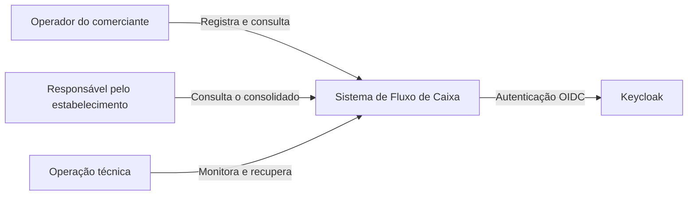
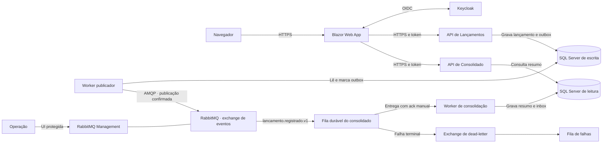
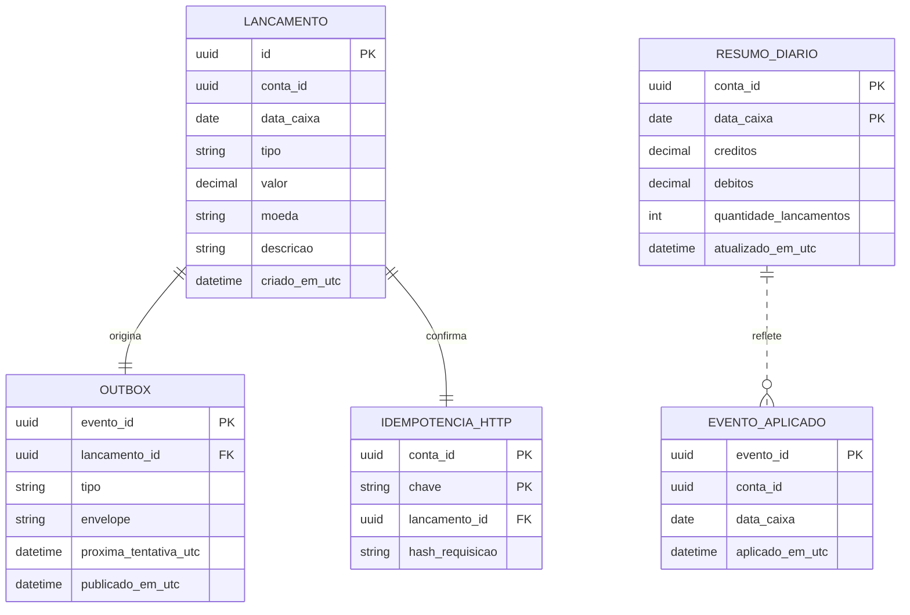
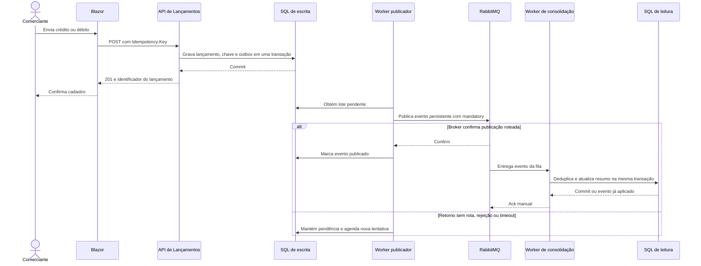
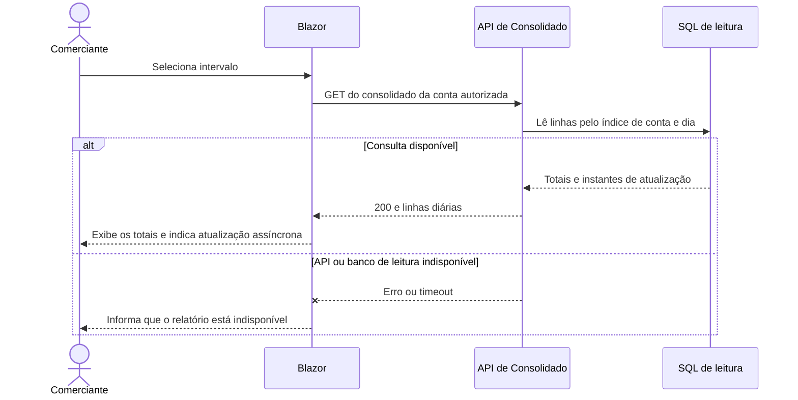
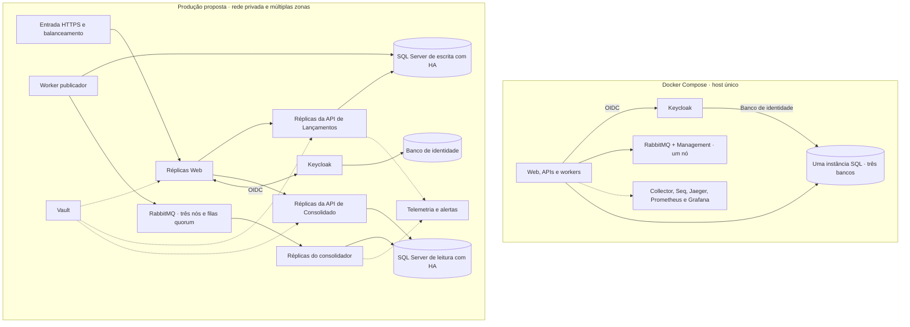

# Desenho da solução

[Voltar ao índice](index.md)

O [catálogo tecnológico](stack.md) reúne as ferramentas, a forma de ativação e o mapa de dependências técnicas.

## Contexto do sistema

A API de Lançamentos é dona do histórico. O Consolidado mantém uma projeção descartável e reconstruível a partir desse histórico. O caminho de escrita termina no banco de Lançamentos. Consultas ao consolidado e chamadas ao broker não fazem parte da transação de registro. A web apresenta telas de registro, histórico e relatório, com tratamento independente de indisponibilidade para cada fluxo.

A arquitetura usa serviços independentes e integração orientada a eventos, com separação entre escrita e leitura (CQRS). Lançamentos confirma a escrita no próprio banco, e o Consolidado atualiza sua projeção de forma assíncrona. A projeção pode ficar temporariamente defasada durante uma falha. As decisões de separar os serviços, usar outbox e escolher o RabbitMQ estão nas [ADRs 01 a 04](decisoes.md).

## Contêineres e dependências

| Componente | Tecnologia e execução | Responsabilidade |
| --- | --- | --- |
| Web | Blazor Web App em .NET 11, renderização estática no servidor | Fluxos de registro, histórico e relatório. Mantém sessão web e chama as APIs com identidade do usuário |
| APIs | Dois processos ASP.NET Core Minimal API em .NET 11 | Validação, autorização, OpenAPI e Scalar local. Escrita e leitura têm escalabilidade independente |
| Publicador | Worker nativo .NET 11 com `BackgroundService` | Lê lotes da outbox, publica e registra o resultado |
| Consolidador | Worker nativo .NET 11 com `BackgroundService` | Consome eventos, aplica projeções, deduplica e confirma entregas |
| Mensageria | RabbitMQ com Management | Roteamento, persistência da fila, redelivery, retry e dead-letter |
| Dados | SQL Server 2022 Developer no ambiente local | Bancos de Lançamentos, Consolidado e Identidade, com credenciais próprias |
| Identidade | Keycloak no Compose | Autenticação por OIDC, tokens de acesso e papéis por API. O [desenho de identidade](identidade-e-acesso.md) detalha login e isolamento por conta |

## Dados, transações e índices

- **Escrita.** Uma transação registra lançamento, chave de idempotência e outbox. Índice único por conta e chave. Histórico indexado por conta, data e identificador para paginação estável. A outbox tem índice de trabalho para localizar eventos ainda pendentes e elegíveis.
- **Leitura.** Uma transação insere o identificador do evento na inbox e incrementa o total diário e a quantidade de lançamentos de forma atômica. O acesso concorrente à linha de conta e dia serializa o incremento. Em disputa pela primeira inserção usa-se uma estratégia transacional de atualização ou inserção com retentativa segura. A chave primária do resumo atende à consulta por conta e intervalo. A relação entre resumo e inbox indica efeito lógico.
- **Dinheiro.** Valores de lançamento em `decimal(19,2)`, positivos, com tipo crédito ou débito. Totais agregados com precisão maior. O líquido é calculado como créditos menos débitos da conta e data da linha. Um lançamento retroativo atualiza apenas essa linha. [ADR-11](decisoes.md#adr-11-saldo-diário-como-movimento-líquido) A restrição de moeda e a data de caixa também são validadas na borda e no consumo.
- **Ordem.** A projeção de créditos e débitos é aditiva e aceita eventos fora de ordem. O instante da última aplicação comprova atualização daquele resumo e pode coexistir com eventos anteriores ainda pendentes.

## Registro e entrega assíncrona

O publicador começa com uma réplica. Se precisar escalar, a captura de lotes usa reserva com prazo de expiração e token de posse, sem manter a transação SQL aberta durante a comunicação com RabbitMQ. Tanto uma confirmação ambígua quanto uma queda entre a confirmação e a marcação da outbox podem causar republicação do mesmo evento. Preserva-se o `eventId` em toda tentativa.

| Objeto de mensageria | Configuração proposta |
| --- | --- |
| Vhost | `fluxo-caixa`, com identidades de publicação, consumo e operação distintas |
| Exchange | `caixa.lancamentos`, durável, tipo topic |
| Rota e fila | `lancamento.registrado.v1` → `caixa.consolidado.v1`, fila quorum durável |
| Dead-letter | Exchange durável `caixa.falhas`, rota `consolidado.v1.falha`, fila durável `caixa.consolidado.v1.dlq` |
| Política da fila principal | `dead-letter-strategy=at-least-once`, `overflow=reject-publish`, `delivery-limit=5` e limites de fila definidos conforme a capacidade local. O broker devolve rejeição ao publicador quando o limite da fila impedir o envio |
| Retentativas | Publicador reagenda falhas transitórias na outbox com backoff e jitter. O consumidor AMQP 0-9-1 rejeita com reenvio (`basic.reject`, `requeue=true`) em falhas transitórias. A política `delayed-retry-type=failed` propõe atraso mínimo de 1 s, máximo de 5 s e limite de entregas. Falhas de contrato usam rejeição sem reenvio e seguem para a DLQ |

A implementação fixará uma versão estável do RabbitMQ a partir da 4.3, que introduziu retry atrasado em filas quorum. O teste de integração verificará que a rejeição com reenvio incrementa a contagem de falhas e que a configuração encaminha a mensagem à DLQ no limite esperado. A rejeição sem reenvio e a transferência segura à DLQ também serão verificadas. A inicialização cria todos os vínculos antes de liberar os workers. A fila é criada com um membro no Compose e três na arquitetura-alvo. [Quorum queues e dead-lettering](https://www.rabbitmq.com/docs/quorum-queues) · [Confirmações de publicação e consumo](https://www.rabbitmq.com/docs/confirms)

## Consulta diária e degradação

| Falha | Efeito durante o incidente | Retomada |
| --- | --- | --- |
| API de Consolidado parada | Relatório indisponível. A projeção pode continuar | Restaurar a API sem interromper registro ou consumo |
| Worker de consolidação, ou banco de leitura, fora | Eventos acumulam na fila, em retry ou DLQ conforme a falha. Quando o banco ainda estiver consultável, o relatório pode servir o último estado gravado | Restaurar dependência, drenar pendências e reconciliar com lançamentos |
| RabbitMQ indisponível | API de Lançamentos continua confirmando enquanto seu SQL suportar a carga. A outbox cresce. A API de Consolidado pode consultar os dados já projetados | Restaurar broker, confirmar roteamento, publicar a outbox e reconciliar |
| Timeout após commit de lançamento | Cliente pode ficar sem saber se o cadastro ocorreu | Reenviar com a mesma chave, recuperando o lançamento confirmado |
| Falha após commit do resumo e antes de ack | RabbitMQ pode reentregar | Restrição de evento aplicado impede segundo efeito no saldo |
| SQL de escrita indisponível | Cadastro retorna indisponibilidade. Nenhum cadastro sem commit recebe sucesso | Recuperar o SQL. Repetir com a mesma chave para resolver resultados ambíguos |
| Coletor ou visualizadores indisponíveis | Redução de sinais operacionais | Recuperar telemetria. Envio de sinais em lote com limites, independente do caminho de negócio |

O [plano de operação](operacao.md) detalha diagnóstico, recuperação e segurança. Os [contratos](contratos.md) descrevem o conteúdo HTTP e AMQP.

## Implantação local e arquitetura-alvo

No ambiente local, persistir os volumes de SQL Server e RabbitMQ e manter portas administrativas restritas ao host. Health checks do Compose ajudam a sinalizar dependências, sem tornar o broker ou o banco de leitura pré-requisitos da API de Lançamentos. A sobreposição de observabilidade acrescenta o Collector e os visualizadores. O setup gera as credenciais locais em `.env`. Vault está previsto na arquitetura-alvo.

Na arquitetura-alvo, os armazenamentos de escrita e leitura ficam em instâncias independentes. As réplicas HTTP ficam atrás de balanceamento. No Compose, o Blazor guarda as sessões em memória. A implantação com múltiplas réplicas exige um armazenamento de sessões compartilhado que preserve a revogação no logout, além de chaves de proteção de dados compartilhadas entre réplicas autorizadas. A API de leitura escala por latência e saturação. O consolidador escala por atraso e profundidade da fila, com limite para proteger o SQL. O publicador pode começar com uma réplica supervisionada e evoluir com reserva de lotes. O cluster RabbitMQ proposto tolera a perda de um membro se os dois restantes estiverem saudáveis. O Compose demonstra falhas de processo e de serviço em host único. Failover entre zonas e desastre de infraestrutura exigem validação no ambiente-alvo.

**Transição.** O exercício é greenfield e o enunciado não fornece legado. A primeira entrada em produção prevê criar os bancos, a topologia e as credenciais, verificar probes e realizar um cadastro com consulta de ponta a ponta antes de liberar tráfego. Mudanças posteriores de eventos usam compatibilidade aditiva em v1 ou nova rota versionada, com consumidores preparados antes dos produtores. Migrações de banco seguem expansão antes da remoção de campos antigos.
